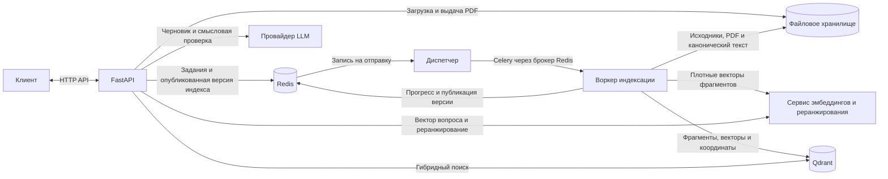
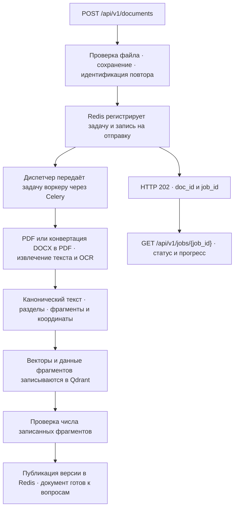
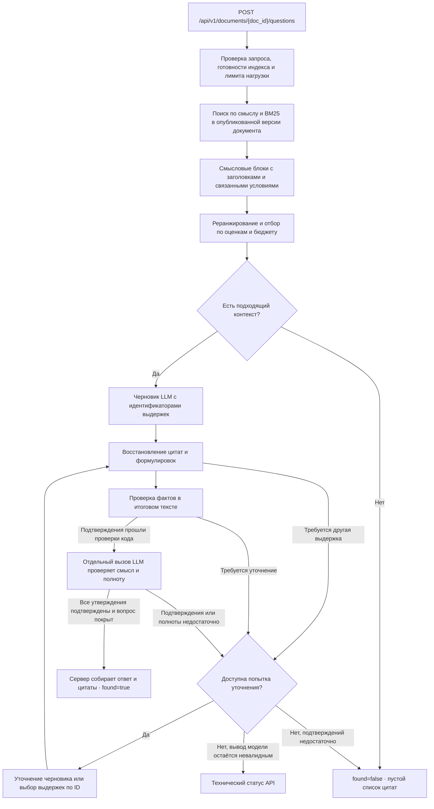

# Архитектура и проверки сервиса поиска по документам

Сервис принимает PDF и DOCX, индексирует их в фоне и отвечает на вопросы по одному выбранному документу. Ответ сопровождается выдержками с номерами страниц и символьными координатами. Каждый вопрос обрабатывается независимо, а если подтверждений для полного ответа недостаточно, API возвращает `found=false` и пустой список цитат.

## Компоненты сервиса

Redis хранит состояния задач и указатель на опубликованную версию индекса. Qdrant хранит фрагменты и по два вектора на фрагмент — плотный для смыслового поиска и разреженный BM25 для поиска по словам, терминам и обозначениям. Файловое хранилище содержит исходники, PDF и результаты разбора. FastAPI и воркер используют общий сервис эмбеддингов и реранжирования. Провайдер LLM зависит от профиля запуска. [Состав контейнеров](compose.yaml) · [Профили моделей](README.md#профили-моделей)

## Загрузка и публикация индекса

| Этап | Проверки и результат |
|---|---|
| **Приём файла** | API проверяет заявленный MIME-тип, сигнатуру и размер файла, а также длину заголовка. По умолчанию предел файла составляет 25 МиБ, заголовка — 500 символов. Файл сохраняется под серверным именем, при записи рассчитывается SHA-256. [Приём документа](app/api/documents.py) · [Запись файла](app/storage/file_store.py) |
| **Идемпотентность** | Отпечаток загрузки учитывает содержимое файла, заголовок и настройки. При повторном использовании ключа сервис сверяет отпечаток и при совпадении возвращает прежние `doc_id` и `job_id`. Если ключ не передан, сервис формирует его из отпечатка. Redis атомарно регистрирует задачу, ключ и запись на отправку. [Отпечаток загрузки](app/domain/fingerprint.py) · [Реестр задач](app/storage/redis_repo.py) |
| **Разбор документа** | DOCX конвертируется в PDF через LibreOffice. Для PDF проверяются возможность чтения, шифрование, лимит страниц и пригодность текстового слоя. По умолчанию лимит составляет 100 страниц. Для страниц с изображениями и недостаточным текстовым слоем запускается Tesseract на русском и английском. После OCR проверяется, достаточно ли в документе читаемых страниц. [Подготовка документа](app/ingestion/pipeline.py) · [Проверки PDF](app/ingestion/pdf_loader.py) · [OCR](app/ingestion/ocr.py) |
| **Разбиение на фрагменты** | Текст нормализуется с сохранением связи с физическими страницами. Определяются разделы, связи подпунктов с вводными положениями и ссылки именованных областей на приложения. При неоднозначном номере приложения учитывается явно названный владелец. Размер фрагмента по умолчанию — 450 токенов, перекрытие — 64 токена. Для каждого фрагмента сохраняются текст, раздел, страницы и символьные границы. [Канонический текст](app/ingestion/canonical.py) · [Разбиение](app/ingestion/chunker.py) · [Связи областей](app/ingestion/scopes.py) |
| **Запись индекса** | Воркер проверяет наличие фрагментов, совместимость схемы Qdrant и отпечатка индекса, число векторов в каждом пакете, их размерность и стабильность версии модели. Отпечаток учитывает модель эмбеддингов, параметры разбора и разбиения, настройки BM25. [Запись в Qdrant](app/jobs/indexer.py) · [Отпечаток индекса](app/domain/index_fingerprint.py) |
| **Публикация и восстановление** | Воркер удерживает право на выполнение задачи и сверяет точное число записанных фрагментов. После отметки о завершении записи Redis атомарно принимает эту версию индекса. Механизм восстановления проверяет задачи без активного владельца и может завершить публикацию проверенной версии, вернуть задачу в очередь или убрать записи незавершённой попытки. [Воркер](app/jobs/tasks.py) · [Публикация](app/storage/job_lifecycle_sync.py) · [Восстановление задач](app/jobs/reconciler.py) |

Клиент проверяет прогресс по `GET /api/v1/jobs/{job_id}`. Список и карточка документов показывают `ready`, а карточка готового документа содержит число страниц и фрагментов и список страниц OCR. Страницы цитат можно сверить с PDF по `GET /api/v1/documents/{doc_id}/normalized`. [Маршруты документов](app/api/documents.py) · [Схема статуса задачи](app/schemas/jobs.py)

## Обработка вопроса

### Проверки запроса и поиска

1. **Вопрос и документ.** API проверяет схему запроса, убирает пробелы по краям и требует непустой вопрос. По умолчанию действует предел в 4 000 символов и один параллельный вопрос на экземпляр API. Сервис проверяет существование документа, завершённую индексацию и наличие опубликованной версии. [Схема запроса](app/schemas/qa.py) · [Обработчик вопросов](app/api/questions.py)
2. **Область поиска.** Вектор вопроса должен соответствовать отпечатку опубликованного индекса. Смысловая ветка и BM25 используют один фильтр по `doc_id`, `ingestion_run_id` и `index_fingerprint`. Qdrant объединяет результаты по RRF по умолчанию. В конфигурации также доступен DBSF. [Гибридный поиск](app/retrieval/search.py)
3. **Контекст для модели.** До реранжирования сервис проверяет область кандидата, включая приложения, на которые она ссылается. Каждый кандидат оценивается вместе с применимыми заголовками, вводными положениями, определениями и связанными условиями. Сервис проверяет конечность всех оценок. Блоки перебираются в порядке убывания оценки, при равенстве по ID. Блок входит целиком, если все его новые фрагменты укладываются в лимит источников и токенов. По умолчанию каждая ветка отдаёт до 60 кандидатов, на реранжирование поступает до 60 блоков, а в контекст входит до восьми фрагментов. [Реранжирование и отбор](app/retrieval/search.py) · [Настройки](app/config/settings.py)

### Проверки черновика и ответа

| Проверка | Что требуется для выдачи ответа |
|---|---|
| **Формат черновика** | Черновик соответствует JSON-схеме. Каждому утверждению сопоставлены выдержки. Признак наличия ответа согласован со списком утверждений и недостающих сведений. [Схемы LLM](app/qa/schemas.py) |
| **Происхождение цитаты** | Указанные ID принадлежат выделенным выдержкам текущего контекста. Сервер сам извлекает текст цитаты из канонического текста фрагмента, определяет физические страницы и символьные границы. Цитаты на распознанных страницах помечаются `ocr_pages`. [Выделение выдержек](app/qa/evidence.py) · [Восстановление цитат](app/qa/grounding.py) · [Сборка ответа](app/qa/assemble.py) |
| **Суммы, сроки и количества** | У числа проверяются значение, единица и роль в утверждении. У распознанных сроков и лимитов учитываются тип дней, точка отсчёта, граница и база процента. При совпадении объекта и явном приоритете источника противоречащее значение отклоняется с причиной для следующей попытки. Для цены в тарифной таблице проверяются строка услуги, количество, заголовок столбца и связанная сноска. [Числовые факты](app/qa/numbers.py) · [Приоритет источника](app/qa/relevance.py) · [Условия лимитов](app/qa/limits.py) · [Тарифные строки](app/retrieval/offer_details.py) |
| **Смысл и границы правила** | Для распознанных правил код проверяет роли сторон, разрешение или запрет, условия и исключения. У подпункта учитывается вводная фраза, задающая адресата и применимость. При сравнении проверяется охват названных в вопросе областей, например двух приложений. Правила восстановления могут добавить условие из однозначно связанной выдержки контекста. [Сверка правил](app/qa/grounding.py) · [Уточнение области ответа](app/qa/relevance.py) · [Условия из источника](app/qa/source_details.py) |
| **Смысловая проверка LLM** | Отдельный вызов модели проверяет, следует ли каждое утверждение из его цитат и покрывает ли ответ все части вопроса. Для выдачи требуется ровно один вердикт `supported` на каждое утверждение и покрытие `full`. При доступном бюджете сервис может передать модели причину отклонения или попросить выбрать точные выдержки из предложенного списка. [Цикл проверки](app/qa/workflow.py) · [Выбор выдержек](app/qa/extractive.py) |
| **Публичный ответ** | Сервер удаляет дубли цитат и расставляет маркеры `[n]`. Схема проверяет уникальность ID, соответствие маркеров цитатам и корректность диапазонов страниц и символов. Для `found=true` нужны текст и цитаты. Для `found=false` список цитат пуст. [Сборка ответа](app/qa/assemble.py) · [Публичная схема](app/schemas/qa.py) |

## Лимиты времени и диагностика

| Параметр | Как применяется |
|---|---|
| `QA_DEADLINE_S` | Общий бюджет времени на обработку вопроса после допуска. Базовое значение в настройках приложения — 900 с. `./run` по умолчанию задаёт 900 с для локальной LLM с ускорителем, 3 600 с для локальной LLM на CPU и 420 с для облачной LLM. |
| `LLM_READ_TIMEOUT_S` | Предел времени на одну попытку вызова LLM с учётом оставшегося времени вопроса. Базовое значение — 300 с, при запуске на CPU по умолчанию — 1 200 с. Этап гибридного поиска ограничен 300 с и оставшимся бюджетом вопроса. |
| `MAX_REPAIR_ATTEMPTS`, `MAX_LLM_CALLS_PER_QUESTION` | По умолчанию одна попытка уточнения черновика и до четырёх отправленных вызовов LLM на вопрос. В этот предел входят генерация, смысловая проверка и транспортные повторы. |
| `LLM_MAX_ATTEMPTS`, `QDRANT_MAX_ATTEMPTS` | При временной недоступности по умолчанию допускается до двух транспортных попыток на вызов LLM и до трёх попыток на операцию с Qdrant. |
| `INDEXING_SOFT_TIME_LIMIT_S`, `JOB_MAX_ATTEMPTS` | По умолчанию мягкий предел одной попытки индексации — 900 с, жёсткий предел Celery — на 180 с больше. Для задачи доступно до трёх попыток выполнения. |

Значения можно задать через окружение или `.env`. [Пример настроек](.env.example) · [Выбор параметров запуска](scripts/resolver.py) · [Бюджет времени по этапам](app/reliability/deadline.py) · [Настройки воркера Celery](app/jobs/celery_app.py)

- `GET /health/live` показывает, отвечает ли API. `GET /health/ready` проверяет Redis, Qdrant, сервис эмбеддингов и реранжирования и доступность настроенной модели LLM. `GET /health/build` возвращает идентификатор экземпляра и отпечаток сборки. [Маршруты проверки готовности](app/api/health.py)
- `debug=true` в запросе вопроса добавляет счётчики поиска, ID фрагментов контекста и цитат, оценки реранкера, время этапов поиска, идентификаторы моделей, расход токенов и стадию отказа при его наличии. [Диагностика вопроса](app/api/questions.py)

## Как проверяют сервис

- **Модульные тесты** проверяют схемы API, разбор документов, работу с цитатами, числовые факты, условия, границы источников и обработку черновиков. CI дополнительно проверяет типы, стиль кода, скрипты запуска и конфигурацию Compose. [Модульные тесты](tests/unit) · [Конфигурация CI](.github/workflows/ci.yml)
- **Интеграционные тесты** проверяют на запущенных компонентах публикацию индекса, изоляцию документов и версий, повторную доставку задачи и восстановление после остановки воркера. `sh eval/demo.sh` выполняет сценарий через публичный API — загружает документы, ждёт их готовности и проверяет ответы, цитаты, штатный отказ и изоляцию. [Интеграционные тесты](tests/integration) · [Демо](README.md#запустить-и-проверить)
- **Оценка на документах** сверяет ответы с размеченными вопросами. Проверяются полнота обязательных фактов и условий, смысловая поддержка, совпадение текста цитат, документа, страниц и координат, а также результат при отсутствии сведений и при подмене документа. Задержки измеряются последовательно на прогретом API. [Методика оценки и замера](eval/README.md)
