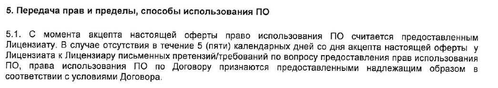

# Проверка скана «Виртуальная АТС»

21 ноября 2026 года сервис через публичный API принял и успешно проиндексировал два PDF. В исходном семистраничном договоре на каждой странице было одно изображение и отсутствовал текстовый слой. Во втором PDF первая страница взята из текстового договора Litender, вторая — из физической страницы 3 договора о виртуальной АТС.

| Документ | Распознаны страницы | Фрагменты опубликованной версии |
|---|---|---|
| Исходный скан, 7 страниц | 1–7 | 102 |
| Смешанный PDF, 2 страницы | 2 | 25 |

К смешанному PDF задали вопрос о сроке письменных претензий по предоставлению права использования ПО. Сервис ответил **«5 (пяти) календарных дней со дня акцепта»** и привёл всё предложение пункта 5.1. В ответе указаны физическая страница 2, диапазон символов `[6414, 6727)` и `ocr_pages=[2]`. Переносы строк сохранены. Текст и обе границы проверены по каноническому тексту. Все непробельные символы предложения совпали с изображением.

Исходный договор доступен для визуальной сверки на [странице 3](../../../test_documents/06_Лицензия_Виртуальная_АТС.pdf#page=3). В отчёте сохранены точный текст вопроса и ответа, координаты, версии OCR и Poppler, хэши сборки и файлов, идентификаторы документов и опубликованных попыток. [Запись прогона](run.json)
